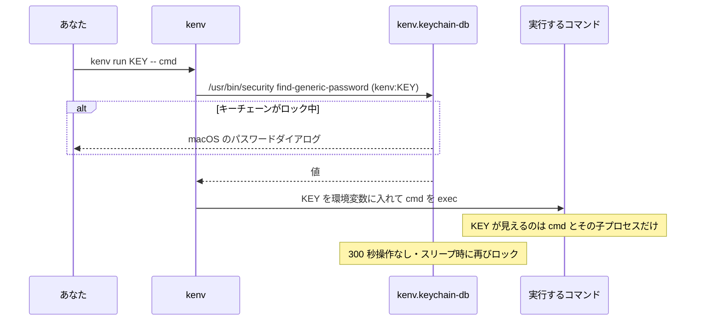

<p align="center">
  
</p>

<p align="center">
  <a href="https://github.com/masaki39/kenv/releases"></a>
  
  
  <a href="LICENSE"></a>
</p>

<p align="center"><a href="README.md">English</a> · <b>日本語</b></p>

# kenv

API キーを**自動でロックされる専用の macOS キーチェーン**に保存し、**必要なコマンドにだけ**環境変数として渡す CLI です。

```zsh
kenv set OPENAI_API_KEY                      # 入力は非表示
kenv run OPENAI_API_KEY -- python main.py    # このプロセスだけがキーを見られる
```

- `.env` ファイルも、`.zshrc` での `export` も不要です。
- キーチェーンは 5 分操作がないときとスリープ時に自動でロックされます。キーチェーンの検索リストからも外すので、他のアプリから参照されることはありません。
- `/usr/bin/security` を呼ぶだけの zsh スクリプト 1 本です。ビルド不要で、中身をすぐ確認できます。

動作環境：macOS、zsh（macOS 標準のシェル）。

## 仕組み

`kenv run` は指定したキーを専用キーチェーンから読み、自分自身をコマンドに置き換えます。キーを受け取るのはそのコマンド（とその子プロセス）だけです。



## envchain との違い

[envchain](https://github.com/sorah/envchain) は同じ発想の、実績のあるツールです。違いはキーの置き場所です。

| | envchain | kenv |
|---|---|---|
| 保存先 | ログインキーチェーン | 専用キーチェーン |
| ログイン中の状態 | 常に解錠（`--require-passphrase` を付けると読むたびに確認） | 自分で解錠したときだけ開き、N 秒操作がないときとスリープ時に再びロック |
| 検索リスト経由で他アプリから見えるか | 見える | 見えない |
| キーの選び方 | 名前空間単位 | プロジェクト単位（`-p`）または 1 つずつ |

ログインキーチェーンで構わなければ envchain で十分です。

## インストール

```zsh
brew install masaki39/tap/kenv
kenv init        # マシンごとに 1 回：キーチェーンを作成
```

`kenv init` は `~/Library/Keychains/kenv.keychain-db` を作成し、「300 秒操作なし」と「スリープ時」にロックするよう設定して、キーチェーンの検索リストから外します。何度実行しても安全です。キーチェーンがすでにあれば、上の設定をかけ直すだけです。

> [!IMPORTANT]
> `kenv init` は新しいキーチェーンのパスワードを尋ねます。他で使っていないもの（ログインパスワード以外）にしてください。キーチェーンがロックされているときに入力します。

ロックまでの時間を変えるには、`KENV_LOCK_AFTER`（秒）を付けて init を再実行します。

```zsh
KENV_LOCK_AFTER=600 kenv init
kenv status
# keychain: ~/Library/Keychains/kenv.keychain-db
# state:    unlocked
# lock:     after 600s idle and on sleep
```

`kenv status` は、キーチェーンが解錠されているときに現在の時間を表示します。

## 使い方

```zsh
# 保存
kenv set OPENAI_API_KEY                        # TTY では非表示の入力
printf %s "$value" | kenv set OPENAI_API_KEY   # 標準入力からも可（スクリプトやエージェント向け）

# 使う
kenv run OPENAI_API_KEY -- some-cmd            # some-cmd にだけ export
kenv run GITHUB_TOKEN NPM_TOKEN -- some-cmd    # 複数指定

# プロジェクト用キー：PROJ/NAME で保存し、NAME として渡す
kenv set projA/OPENAI_API_KEY
kenv set projA/DATABASE_URL
kenv run -p projA -- uv run main.py            # OPENAI_API_KEY と DATABASE_URL が渡る
kenv run -p projA SENTRY_DSN -- uv run main.py # プロジェクトのキー＋グローバルのキー

# 確認・削除
kenv ls              # グローバルのキーとプロジェクト一覧（名前のみ）
kenv ls projA        # projA のキー
kenv get OPENAI_API_KEY
kenv rm OPENAI_API_KEY
kenv rm projA/       # projA のキーをすべて削除

# ロック状態
kenv status
kenv lock
kenv unlock          # ターミナルでパスワード入力（ダイアログが出ない ssh 越しで使う）
```

- ロック中にキーを読むと、kenv キーチェーンのパスワードを求める macOS のダイアログが出ます。
- `kenv run` はすべてのキーを読み終えてから、自分自身をコマンドに置き換えます（`exec`）。値を持ったまま残る余分なプロセスはありません。
- グローバルのキーとプロジェクトのキーが同じ名前のときは、グローバルのキーが優先され、警告が出ます。
- `kenv get` は値の後ろに改行を付けて出力します。
- キー名は環境変数名として正しい必要があります。`set` と `run` は、zsh の特殊変数・読み取り専用変数（`PATH`、`HOME`、`IFS`、`LANG`、`TERM` など）と、`_kenv_` で始まる名前を受け付けません。
- 値は印字可能な ASCII 文字だけの 1 行にしてください（タブ・制御文字・非 ASCII 文字は不可）。API キーやトークンならこの条件を満たします。長さの上限は約 1900 文字です（`security -i` が長い行を扱えないため）。超える値は何も書き込まずに拒否します。
- `kenv help` で全コマンド、`kenv <コマンド> -h` でそのコマンドの使い方を表示します。

### コマンドに自動でキーを渡す

kenv はシェルの設定を変更しません。`~/.zshrc` に小さなラッパー関数を書いてください。

```zsh
czg() { kenv run CZ_OPENAI_API_KEY -- czg "$@" }
```

関数の中でも、`--` の後の `czg` はシェルではなく kenv が実行します。そのため本物のコマンドが起動し、関数が自分自身を呼び続けることはありません。

### 補完

Homebrew でインストールすると zsh の補完（`_kenv`）も入ります。補完に出るのはキー名だけで、値は読みません。

## 応用

<details>
<summary><b>カスタムキーチェーン</b></summary>

別のキーチェーンファイルを使うときは `KENV_KEYCHAIN` を設定します（例：`~/.zshenv`）。パスは絶対パスで、`.keychain-db` で終わる必要があります。

```zsh
export KENV_KEYCHAIN=$HOME/Library/Keychains/work.keychain-db
export KENV_LOCK_AFTER=600     # 任意：ロックまでの秒数（既定 300）
kenv init                      # 作成してロック設定をかける
```

既存のキーチェーンを使う場合も、`KENV_KEYCHAIN` にそのファイルを指定して `kenv init` を実行します。kenv が扱うのはサービス名が `kenv:` で始まる項目だけなので、そのキーチェーンにある他の項目には触れません。

</details>

<details>
<summary><b>キーチェーンアクセスで中身を見る</b></summary>

kenv のキーチェーンは検索リストから外してあるため、そのままではキーチェーンアクセスに表示されません。

1. キーチェーンアクセスを開きます（`open -a "Keychain Access"`）。
2. **ファイル → キーチェーンを追加…** で `~/Library/Keychains/kenv.keychain-db` を選びます（<kbd>⌘⇧G</kbd> でパスを直接入力できます）。
3. `kenv:OPENAI_API_KEY` のような名前で項目が表示されます。
4. 見終わったら `kenv init` を再実行してください。追加したことで検索リストに戻っています。`kenv status` を実行すると警告が出ます。

</details>

## AI コーディングエージェントと使うとき

エージェントはあなたの権限でコマンドを実行するので、実行できるものは読めてしまいます。エージェントの設定で、キーを読む手段を拒否してください。エージェントに `kenv set` でキーを登録させるのは問題ありません。ただし値は自分で入力してください。

<details>
<summary><b>Claude Code：<code>~/.claude/settings.json</code></b></summary>

```json
{
  "permissions": {
    "deny": [
      "Bash(kenv get*)",
      "Bash(kenv run*)",
      "Bash(security *)",
      "Bash(/usr/bin/security*)",
      "Bash(command security*)"
    ]
  }
}
```

</details>

> [!WARNING]
> これは完全な防御ではありません。シェルを入れ子にしたりスクリプトを使ったりすれば回避できます。本当の防御は、キーをシェル全体に export しないことと、キーチェーンがほとんどの時間ロックされていることです。

## セキュリティモデル

| 脅威 | 対策 |
|---|---|
| スクリプトが `.env` やシェルの環境変数を読む | ファイルにもシェルの環境変数にも置かない |
| アプリが標準のキーチェーンを探索する | kenv のキーチェーンは検索リストに入っていない |
| 離席中やスリープ明けに他人が Mac を使う | キーチェーンがロックされていて、読むにはパスワードが要る |
| **解錠中に**あなたの権限で動く任意のプロセス | **防げません**：`/usr/bin/security` を通じて、確認なしに全キーを読めます |

kenv は項目を `/usr/bin/security` で作成します。キーチェーンの既定のアクセス設定は、項目を作ったアプリを信頼します。そのため解錠中（操作なしの時間が過ぎるかスリープで再ロックされるまで）は、あなたの権限で動くプログラム（たとえば npm の `postinstall` スクリプト）が `/usr/bin/security` を呼べば、ダイアログなしでキーを読めます。この時間が気になる場合は、使い終わったら `kenv lock` を実行してください。

また、値は実行したコマンド（とその子プロセス）の環境変数に、そのコマンドが動いている間は残ります。

## アンインストール

```zsh
brew uninstall kenv
security delete-keychain ~/Library/Keychains/kenv.keychain-db
```

> [!CAUTION]
> `security delete-keychain` は kenv キーチェーンに保存したキーをすべて削除します。元に戻せません。

## ライセンス

MIT
