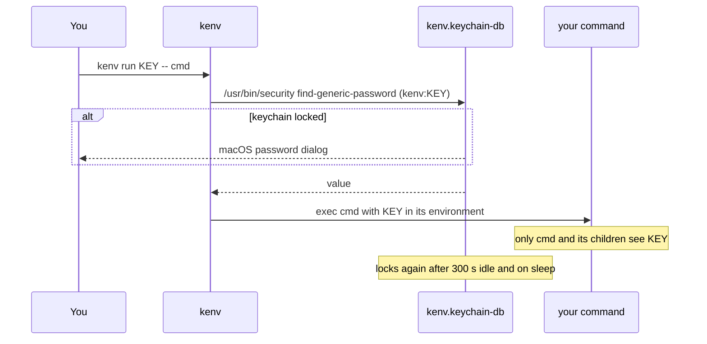

<p align="center">
  
</p>

<p align="center">
  <a href="https://github.com/masaki39/kenv/releases"></a>
  
  
  <a href="LICENSE"></a>
</p>

<p align="center"><b>English</b> · <a href="README.ja.md">日本語</a></p>

# kenv

Keep API keys in a **dedicated, auto-locking macOS keychain** and hand them to **one command at a time** as environment variables.

```zsh
kenv set OPENAI_API_KEY                      # hidden prompt
kenv run OPENAI_API_KEY -- python main.py    # only this process sees the key
```

- No `.env` files, no `export` in `.zshrc`.
- The keychain locks after 5 minutes idle and on sleep, and is kept out of the keychain search list, so other apps never query it.
- A single zsh script on top of `/usr/bin/security`. Nothing to compile, easy to audit.

Requirements: macOS, zsh (the default shell).

## How it works

`kenv run` reads the keys you name from its own keychain, then replaces itself with your command, so only that command (and its children) gets them.



## Why not envchain?

[envchain](https://github.com/sorah/envchain) is a mature tool with a similar idea. The difference is where the keys live:

| | envchain | kenv |
|---|---|---|
| Storage | login keychain | its own keychain |
| While you are logged in | unlocked (or a prompt on every read with `--require-passphrase`) | unlocked only after you unlock it, and re-locked after N seconds idle and on sleep |
| Visible to other apps via the search list | yes | no |
| Selecting keys | whole namespace | whole project (`-p`) or individual keys |

If you are fine with the login keychain, use envchain.

## Install

```zsh
brew install masaki39/tap/kenv
kenv init        # once per machine: create the keychain
```

`kenv init` creates `~/Library/Keychains/kenv.keychain-db`, sets it to lock after 300 s idle and on sleep, and removes it from the keychain search list. It is safe to re-run: on an existing keychain it only re-applies those settings.

> [!IMPORTANT]
> `kenv init` asks for a password for the new keychain. Choose one you do not use anywhere else (not your login password). You type it whenever the keychain is locked.

To change the idle timeout, re-run init with `KENV_LOCK_AFTER` (seconds):

```zsh
KENV_LOCK_AFTER=600 kenv init
kenv status
# keychain: ~/Library/Keychains/kenv.keychain-db
# state:    unlocked
# lock:     after 600s idle and on sleep
```

`kenv status` shows the timeout while the keychain is unlocked.

## Usage

```zsh
# store
kenv set OPENAI_API_KEY                        # hidden prompt on a TTY
printf %s "$value" | kenv set OPENAI_API_KEY   # or from stdin (scripts, agents)

# use
kenv run OPENAI_API_KEY -- some-cmd            # export only to some-cmd
kenv run GITHUB_TOKEN NPM_TOKEN -- some-cmd    # several keys

# project keys: stored as PROJ/NAME, exported as NAME
kenv set projA/OPENAI_API_KEY
kenv set projA/DATABASE_URL
kenv run -p projA -- uv run main.py            # gets OPENAI_API_KEY and DATABASE_URL
kenv run -p projA SENTRY_DSN -- uv run main.py # project keys + a global key

# inspect / delete
kenv ls              # global keys and projects (names only)
kenv ls projA        # keys of projA
kenv get OPENAI_API_KEY
kenv rm OPENAI_API_KEY
kenv rm projA/       # every key of projA

# lock state
kenv status
kenv lock
kenv unlock          # password in the terminal (use over ssh, where no dialog appears)
```

- When the keychain is locked, reading a key shows the macOS password dialog for the kenv keychain.
- `kenv run` reads every key first and only then replaces itself with the command (`exec`), so no extra process holds the values.
- If a global key and a project key have the same name, the global key wins and kenv prints a warning.
- `kenv get` prints the value followed by a newline.
- Key names must be valid environment variable names. `set` and `run` refuse zsh special or read-only variables (`PATH`, `HOME`, `IFS`, `LANG`, `TERM`, ...) and names starting with `_kenv_`.
- Values must be a single line of printable ASCII (no tabs, control or non-ASCII characters), which covers API keys and tokens. The limit is about 1900 characters (`security -i` cannot take longer lines); longer values are refused without writing anything.
- `kenv help` lists every command; `kenv <command> -h` shows the usage of one.

### Give a command its keys automatically

kenv does not touch your shell. Write a small wrapper function in `~/.zshrc`:

```zsh
czg() { kenv run CZ_OPENAI_API_KEY -- czg "$@" }
```

Inside the function, `czg` after `--` is executed by kenv, not by the shell, so it runs the real binary and does not recurse.

### Completion

The Homebrew formula installs zsh completion (`_kenv`). Key names are completed; values are never read.

## Advanced

<details>
<summary><b>Custom keychain</b></summary>

Set `KENV_KEYCHAIN` (for example in `~/.zshenv`) to use another keychain file. The path must be absolute and end in `.keychain-db`.

```zsh
export KENV_KEYCHAIN=$HOME/Library/Keychains/work.keychain-db
export KENV_LOCK_AFTER=600     # optional: idle seconds before it locks (default 300)
kenv init                      # creates it, applies the lock settings
```

To point kenv at a keychain you already have, set `KENV_KEYCHAIN` to its file and run `kenv init`. kenv only sees items whose service name starts with `kenv:`, so other items in that keychain are left alone.

</details>

<details>
<summary><b>View it in Keychain Access</b></summary>

kenv keeps its keychain out of the search list, so Keychain Access does not show it by default.

1. Open Keychain Access (`open -a "Keychain Access"`).
2. **File → Add Keychain…**, then pick `~/Library/Keychains/kenv.keychain-db` (press <kbd>⌘⇧G</kbd> to type the path).
3. Items appear with names like `kenv:OPENAI_API_KEY`.
4. When you are done, run `kenv init` again. Adding the keychain put it back in the search list; `kenv status` warns about this.

</details>

## Using with AI coding agents

Agents can run commands as you, so anything they can execute they can also read. Deny the read paths in the agent's settings. Letting an agent register a key with `kenv set` is fine, as long as you type the value yourself.

<details>
<summary><b>Claude Code: <code>~/.claude/settings.json</code></b></summary>

```json
{
  "permissions": {
    "deny": [
      "Bash(kenv get*)",
      "Bash(kenv run*)",
      "Bash(security *)",
      "Bash(/usr/bin/security*)",
      "Bash(command security*)"
    ]
  }
}
```

</details>

> [!WARNING]
> These rules are best-effort: a nested shell or a script can bypass them. The real protection is that keys are never exported globally and the keychain is locked most of the time.

## Security model

| Threat | Protection |
|---|---|
| A script reads `.env` or your shell environment | nothing is in files or in the shell's environment |
| An app scans the default keychains | the kenv keychain is not in the search list |
| Someone uses the Mac while you are away, or after sleep | the keychain is locked; reading needs its password |
| Any process running as you **while the keychain is unlocked** | **not protected**: it can read every key through `/usr/bin/security` without a prompt |

kenv creates its items with `/usr/bin/security`, and the keychain's default access rule trusts the app that created an item. So while the keychain is unlocked (until it re-locks after the idle timeout or on sleep), any program running as you that calls `/usr/bin/security`, for example an npm `postinstall` script, can read the keys without a dialog. Run `kenv lock` when you are done if that window matters to you.

Also note that the values are in the environment of the command you run (and of its children) for as long as it runs.

## Uninstall

```zsh
brew uninstall kenv
security delete-keychain ~/Library/Keychains/kenv.keychain-db
```

> [!CAUTION]
> `security delete-keychain` deletes every key stored in the kenv keychain. It cannot be undone.

## License

MIT
